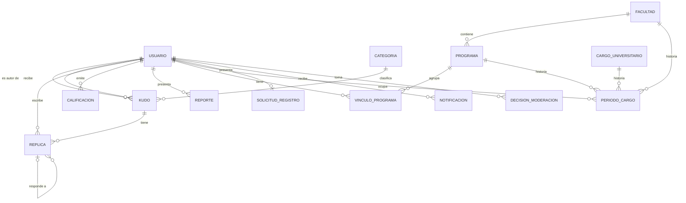

# Modelos del dominio

## 1. Modelo anémico

Primer paso: entender la estructura, sin comportamiento. Solo entidades, atributos, relaciones y cardinalidades.

El detalle completo de cada objeto (atributos, tipos, longitudes, reglas y relaciones) está en `modelos/Modelo_Dominio_Anemico_UCOKudos.xlsx`.

| Entidad | Atributos | Identificador |
|---|---|---|
| Usuario | nombre, correo, correo verificado, celular, celular verificado, clave, rol, estado, aprobador, fecha de aprobación, fecha de registro | UUID |
| Facultad | nombre, fecha de creación | UUID |
| Programa | nombre, facultad, fecha de creación | UUID |
| Cargo universitario | cargo (Rector o Coordinador Académico) | UUID |
| Periodo de cargo | titular, inicio, fin | Cargo + titular + inicio |
| Vínculo a programa | programa, persona, tipo, vinculado en y por, desvinculado en y por | UUID |
| Solicitud de registro | solicitante, rol pedido, afiliación, estado, decidida por y en, motivo de rechazo | UUID |
| Categoría | nombre, descripción, activa, fecha de creación | UUID |
| Kudo | autor, destinatario, categoría, texto, fecha, estado | UUID |
| Réplica | Kudo, réplica padre, autor, texto, fecha, estado | UUID |
| Calificación | calificador, contenido, estrellas, fechas | UUID |
| Reporte | reportante, contenido, motivo, detalle, fecha, estado, resuelto por y en | UUID |
| Decisión de moderación | contenido, moderador, resultado, justificación, reportes resueltos, fecha | UUID |
| Auditoría | tipo de evento, agregado, actor, fecha, evidencia | UUID |
| Notificación | destinatario, mensaje, contenido relacionado, fecha, fecha de lectura | UUID |

Este modelo sirve para ver la forma del problema, pero deja sin dueño cada regla: quién impide un veto indebido, quién activa la cuenta. Si se implementara así, todas esas decisiones acabarían en servicios procedimentales.

## 2. Del modelo anémico al enriquecido

Decisiones que cambian la forma del modelo:

| Cambio | Por qué |
|---|---|
| Estudiante, Docente, Rector y demás **no son subclases** de Usuario, sino valores de `Role` | RN-001 a RN-038 son una sola idea: un rol a la vez. Con un único campo la acumulación es imposible de representar; con herencia, cambiar o validar el rol exigiría cambiar la clase del objeto |
| `Kudo` y `Reply` comparten la clase abstracta `Publication` | Tienen el mismo ciclo de moderación, calificación y reporte; solo difieren en sus eventos y su relación con el resto |
| Correo, celular, estrellas y código pasan a ser objetos de valor | Un valor inválido no se puede construir, así que la validación no se repite |
| Los periodos de cargo se reúnen en `PositionSuccession` | Facultad, Programa y Cargo universitario comparten la misma regla: un titular vigente e historia intacta. Composición en lugar de herencia |
| El contenido calificado o reportado se referencia con `ContentReference` | Calificación y reporte aplican a los dos tipos sin depender de ninguno |

## 3. Modelo enriquecido

Para cada objeto: qué representa, qué conoce, qué hace, qué delega, qué eventos genera y qué reglas protege.

El detalle formal de cada objeto (atributos, responsabilidades, entradas, salidas, políticas y excepciones) está en `modelos/Modelo_Dominio_Enriquecido_UCOKudos.xlsx`.

### Identidad

**UserAccount (agregado).** Una persona con identidad institucional.
- *Conoce:* datos de contacto y su verificación, rol, estado, aprobación.
- *Hace:* verifica contactos, recibe aprobación, actualiza sus datos, se suspende, reactiva y desactiva. Responde `ensureActive`, `ensureManages`, `ensureHasCapability`.
- *Decide:* cuándo pasa a activa: solo con correo, celular y aprobación (RN-084 a RN-089).
- *Delega:* formato a `InstitutionalEmail` y `MobilePhone`; validez del código a `ContactVerification`; la matriz de permisos a `Role`.
- *Eventos:* `UserRegistered`, `EmailVerified`, `PhoneVerified`, `UserApproved`, `AccountActivated`, `AccountSuspended`, `AccountReactivated`, `AccountDeactivated`, `PersonalInformationUpdated`.
- *Colabora con:* `RegistrationRequest`, `OrganizationalAuthority`.

**Role y Capability (enumeraciones).** `Role` concentra a quién gestiona cada rol (`manages`), qué capacidades otorga (`grants`) y si admite autorregistro. Es la respuesta directa a POL-005: un solo lugar define lo que cada autoridad puede hacer.

**Estudiante, Docente, Rector, Coordinador Académico, de Facultad y de Programa.** El enunciado pide analizarlos: son la misma `UserAccount` con distinto `Role`. Lo que varía entre ellos está en `Role` (permisos), `ProgramMembership` (estudiante y docente), `PositionSuccession` (coordinadores) y `UniversityPosition` (Rector y Coordinador Académico).

**Objetos de valor.** `InstitutionalEmail` (dominio `uco.edu.co`), `MobilePhone` (celular colombiano de 10 dígitos), `VerificationCode` y `ContactVerification` (código pendiente, vencimiento, confirmación), `ApprovalRecord` (quién y cuándo).

### Registro

**RegistrationRequest (agregado).** La solicitud de un aspirante y su afiliación pedida.
- *Hace:* se aprueba o rechaza una sola vez, con motivo si es rechazo. Impide que el aprobador sea el mismo solicitante (RN-108).
- *Eventos:* `RegistrationRejected`; la aprobación la registra `UserAccount` con `UserApproved`.

### Organización

**Faculty y AcademicProgram (agregados).** Unidades de la estructura; el programa nace dentro de una facultad y no puede cambiar de ella (RN-049).
- *Hacen:* renombrarse (exige capacidad) y cambiar de coordinador conservando la historia.
- *Delegan:* la sucesión a `PositionSuccession`.
- *Eventos:* `FacultyCreated`, `FacultyRenamed`, `FacultyCoordinatorAssigned`, `FacultyCoordinatorReplaced` y sus equivalentes de programa.

**PositionSuccession.** Historia de quién ocupó un cargo. `handOver` cierra el periodo vigente y abre otro; devuelve el titular anterior para que el agregado decida si fue asignación o reemplazo. Garantiza INV-001 a INV-004.

**UniversityPosition (agregado).** Cargos únicos: Rector y Coordinador Académico. Evento `UniversityAuthorityAssigned`.

**ProgramMembership (agregado).** Un vínculo persona-programa con su inicio y su fin. Cada vínculo es un agregado porque un programa puede tener miles: cargarlos todos para agregar uno no escalaría. Desvincular cierra el registro (INV-013, INV-016). Solo admite estudiantes y docentes.

**OrganizationalAuthority (servicio de dominio).** Decide si un gestor actúa dentro de su ámbito. Es un servicio porque la respuesta necesita varios agregados (cuenta, programas, facultades) y no pertenece a ninguno. `Role.manages` responde "sobre qué rol"; este servicio responde "sobre cuál persona concreta" (POL-004).

**Affiliation (objeto de valor).** Programas o facultad asociados a una solicitud, validados según el rol pedido.

### Reconocimiento

**Publication (clase abstracta sellada).** Lo común a Kudo y Réplica.
- *Hace:* `receiveReport`, `startReview`, `release`, `veto`, `ensureAcceptsInteraction`. Verifica la capacidad de moderación del actor.
- *Delega:* la validez de cada transición a `ModerationStatus` y el evento concreto a sus subclases (`reportedEvent`, `vetoedEvent`).

**Kudo (agregado).** `publish` exige autor activo, destinatario activo y distinto, categoría utilizable y texto no vacío. Copia el nombre de la categoría (RN-145). Eventos: `KudoPublished`, `KudoViewed`, `KudoReported`, `KudoVetoed`.

**Reply (agregado).** Se crea solo con `onKudo` o `answering`, nunca con un padre arbitrario. Como el padre debe existir antes de la hija y no se puede cambiar, no pueden formarse ciclos (INV-028, INV-029). Eventos: `ReplyPublished`, `ReplyAnswered`, `ReplyReported`, `ReplyVetoed`.

**Conversation.** Ordena las réplicas de un Kudo en orden de lectura con su profundidad. Usa una pila explícita para que un hilo muy profundo no desborde la pila de llamadas (RN-164).

**ModerationStatus (estado).** Cada estado sabe qué transiciones admite. Ver patrón State en [05_DATOS_Y_ARQUITECTURA.md](05_DATOS_Y_ARQUITECTURA.md).

**Category (agregado).** Catálogo; exige `MANAGE_CATEGORIES`. `ensureUsableForNewKudos` impide usar una inactiva. Eventos `CategoryCreated`, `CategoryModified`, `CategoryActivated`, `CategoryDeactivated`.

### Interacción y moderación

**Rating (agregado) y StarRating (valor).** Una valoración por persona y contenido; se cambia con `change`, que exige contenido interactivo. `RatingSummary` calcula el indicador. Eventos `RatingRegistered`, `RatingUpdated`, `RatingIndicatorRecalculated`.

**ContentReport (agregado).** Reporte con motivo; recorre `PENDING`, `IN_REVIEW`, `ACCEPTED` o `REJECTED`.

**ModerationDecision (agregado).** Coordina la revisión: aplica el resultado al contenido y a sus reportes abiertos y deja la justificación. Veto significa reportes aceptados; liberación, reportes rechazados (RN-212). Evento `ReviewClosed`.

### Transversales

**AuditEntry y AuditTrail.** Registro inmutable: evento, agregado, actor, fecha y evidencia JSON (RN-250). No tiene operaciones de modificación.

**Notification.** Aviso a una persona; solo su destinatario puede marcarlo como leído.

### Dónde vive cada responsabilidad

| Si la regla... | Va en | Ejemplo |
|---|---|---|
| Depende de un solo valor | Objeto de valor | `StarRating` entre 1 y 5 |
| Depende del estado de un objeto | Entidad o agregado | `UserAccount` decide activarse |
| Necesita varios agregados | Servicio de dominio | `OrganizationalAuthority` |
| Coordina transacción, puertos y eventos | Servicio de aplicación | `KudoService` |

## 4. Límites transaccionales

Cada agregado se guarda en su propia operación de repositorio y referencia a los demás por identificador. Los servicios de aplicación abren una sola transacción por caso de uso, de modo que la auditoría se escribe junto al cambio o no se escribe nada. Los casos de uso que cambian el estado de una publicación bloquean su fila al cargarla, para que dos cambios simultáneos no se sobrescriban.

## 5. Eventos

Todos implementan `DomainEvent` (agregado, actor, fecha). Los agregados los acumulan y el servicio de aplicación los publica después de guardar.

| Enunciado | Evento | Reacciones |
|---|---|---|
| EVT-001 Usuario registrado | `UserRegistered` | Auditoría |
| EVT-002 Correo verificado | `EmailVerified` | Auditoría |
| EVT-003 Celular verificado | `PhoneVerified` | Auditoría |
| EVT-004 Usuario aprobado | `UserApproved` | Auditoría, notificación |
| EVT-005 Cuenta activada | `AccountActivated` | Auditoría |
| EVT-006 Cuenta suspendida | `AccountSuspended` | Auditoría |
| EVT-007 Cuenta desactivada | `AccountDeactivated` | Auditoría |
| Añadido | `AccountReactivated`, `PersonalInformationUpdated`, `RegistrationRejected` | Auditoría |
| EVT-008, EVT-009 | `FacultyCreated`, `ProgramCreated` | Auditoría |
| EVT-010, EVT-011 | `FacultyCoordinatorAssigned`, `FacultyCoordinatorReplaced` | Auditoría |
| EVT-012, EVT-013 | `ProgramCoordinatorAssigned`, `ProgramCoordinatorReplaced` | Auditoría |
| EVT-014, EVT-015 | `UniversityAuthorityAssigned` | Auditoría |
| EVT-016, EVT-018 | `MemberLinkedToProgram` | Auditoría |
| EVT-017, EVT-019 | `MemberUnlinkedFromProgram` | Auditoría |
| Añadido | `FacultyRenamed`, `ProgramRenamed` | Auditoría (RN-097) |
| EVT-020 a EVT-023 | `CategoryCreated`, `CategoryModified`, `CategoryActivated`, `CategoryDeactivated` | Auditoría |
| EVT-024 Kudo creado | `KudoPublished` | Auditoría, notificación al destinatario |
| EVT-025 Kudo consultado | `KudoViewed` | Auditoría |
| EVT-026, EVT-030 | `KudoReported`, `ReplyReported` | Auditoría |
| EVT-027, EVT-031 | `KudoVetoed`, `ReplyVetoed` | Auditoría, notificación al autor |
| EVT-028 Réplica creada | `ReplyPublished` | Auditoría, notificación al autor del Kudo |
| EVT-029 Réplica respondida | `ReplyAnswered` | Auditoría, notificación al autor de la réplica |
| EVT-032, EVT-033, EVT-034 | `RatingRegistered`, `RatingUpdated`, `RatingIndicatorRecalculated` | Auditoría |
| EVT-035 Revisión iniciada | `ReviewStarted` | Auditoría |
| EVT-036 Revisión cerrada | `ReviewClosed` | Auditoría |
| EVT-037 Contenido aprobado | `ContentReleased` | Auditoría |
| EVT-038 Contenido rechazado | `KudoVetoed`, `ReplyVetoed` | Auditoría, notificación |

### Clasificación de los eventos

| Tipo | Qué es | En UCO Kudos | Dónde verlo | Cantidad |
|---|---|---|---|---|
| **Evento de negocio** | Hecho que la institución nombra en su propio lenguaje | EVT-001 a EVT-038, como «Kudo creado» o «Usuario aprobado» | Tabla anterior y reglas RN-213 a RN-242 de `02_REGLAS_DE_NEGOCIO` | 38 |
| **Evento de dominio** | Objeto inmutable que un agregado registra cuando cambia su estado | Un `record` que implementa `DomainEvent`, como `KudoPublished` | `domain/<módulo>/events/` en el Back-End | 39 clases |
| **Evento de integración** | Mensaje con contrato estable que se envía a otro sistema por un canal externo | No aplica: el sistema no publica eventos hacia otros sistemas ni los recibe | Explicación al final de esta sección | 0 |

Los 38 eventos de negocio se implementan con 34 clases. Algunos difieren solo en un dato que viaja dentro del evento (EVT-014 y EVT-015, EVT-016 y EVT-018, EVT-017 y EVT-019), y EVT-038 reutiliza `KudoVetoed` y `ReplyVetoed`. Las otras 5 clases no están en el catálogo EVT: `AccountReactivated`, `PersonalInformationUpdated`, `RegistrationRejected`, `FacultyRenamed` y `ProgramRenamed`. Se agregaron porque las reglas RN-083, RN-097 a RN-100 y RN-109 exigen auditar esos cambios.

Recorrido de un evento:

1. El agregado registra el hecho con `recordEvent`. Todavía no lo publica.
2. El servicio de aplicación guarda el agregado y llama a `events.publishEventsOf(...)`.
3. `SpringDomainEventPublisher` lo entrega a los listeners, de forma síncrona y dentro de la misma transacción.
4. `AuditEventListener` registra los 39 tipos. `NotificationEventListener` delega en `NotificationPolicy`, que reacciona a 6: `KudoPublished`, `ReplyPublished`, `ReplyAnswered`, `KudoVetoed`, `ReplyVetoed` y `UserApproved`.

**Por qué no hay eventos de integración.** Ningún sistema externo consume los hechos de UCO Kudos. El envío de códigos tampoco usa eventos: es una llamada directa al puerto `VerificationCodeSender`. Si otro sistema debiera enterarse de un hecho, un listener nuevo traduciría el evento de dominio a un mensaje propio después de confirmar la transacción (`@TransactionalEventListener(phase = AFTER_COMMIT)`), con una tabla de salida (patrón Outbox) si no se puede perder ningún mensaje. El dominio no cambiaría.

## 6. Políticas

| Política | Mecanismo |
|---|---|
| POL-001, POL-002 Identidad válida | Objetos de valor en la creación de la cuenta |
| POL-003 Identidad antes de ingresar | `AuthenticationService` exige cuenta activa |
| POL-004 Actuar en el propio ámbito | `OrganizationalAuthority` |
| POL-005 Sin funciones superiores | `Role.manages` y `Role.grants` |
| POL-006, POL-007 Trazabilidad | Evento por cada cambio, `AuditEventListener` en la misma transacción |
| Notificación (política propia) | `NotificationPolicy`: traduce eventos en avisos y nunca avisa a quien causó el hecho |

Según lo que protegen:

| Objetivo | Cómo |
|---|---|
| Seguridad | JWT, BCrypt, capacidades por rol verificadas en el dominio |
| Integridad | Invariantes en agregados y restricciones en la base |
| Trazabilidad | Auditoría por eventos con evidencia |
| Consistencia | Una transacción por caso de uso; índices únicos parciales; bloqueo de fila al moderar o reportar |
| Gobernanza | Cadena de aprobación y moderación restringida |

### Clasificación de las políticas

POL-001 a POL-007 son las políticas del enunciado. Cada responsabilidad del modelo enriquecido tiene además su política, su excepción y qué hacer ante ella en `modelos/Modelo_Dominio_Enriquecido_UCOKudos.xlsx`. Aquí se agrupan por su origen. Los identificadores RE, RI y CO pertenecen a esta clasificación.

| Tipo | Qué responde | Ejemplo |
|---|---|---|
| **Regla empresarial** | Cómo funciona el reconocimiento. Seguiría valiendo aunque cambiara el organigrama | Un Kudo reconoce a otra persona |
| **Restricción institucional** | Qué impone la forma en que la Universidad se organiza y se gobierna | Solo Rector y Coordinador Académico moderan |
| **Condición operativa** | Qué debe ser cierto en el momento de ejecutar una operación | La cuenta debe estar activa |

#### Reglas empresariales

| Id | Regla | Fuente | Dónde se aplica | Si no se cumple |
|---|---|---|---|---|
| RE-01 | Un Kudo reconoce a otra persona | CU-001, D-07 | `Kudo.publish`; `ck_kudo_recognizes_someone_else` | 422 |
| RE-02 | Autor y destinatario de un Kudo deben estar activos | INV-017 a INV-019 | `Kudo.publish` | 403 por el autor, 422 por el destinatario |
| RE-03 | Solo las categorías activas reciben Kudos nuevos | RN-144 | `Category.ensureUsableForNewKudos` | 422 |
| RE-04 | El Kudo conserva el nombre de categoría con el que se publicó | RN-145 | `Kudo.categoryNameAtPublication` | No aplica: se copia al publicar |
| RE-05 | El texto no tiene límite y no se recorta | RN-152, RN-153, RN-170 | Columna `TEXT`; `Publication` solo rechaza el texto vacío | 422 si está vacío |
| RE-06 | Las conversaciones no tienen límite de profundidad | RN-163, RN-164 | `Reply.answering`, `Conversation` | No aplica |
| RE-07 | La calificación va de 1 a 5 estrellas | RN-177 | `StarRating`; `ck_rating_stars` | 422 |
| RE-08 | Una calificación por persona y contenido, modificable | RN-178 a RN-181, D-08 | `RatingService.rate`; `uk_rating_one_per_rater_and_content` | 409 si dos llegan a la vez |
| RE-09 | El veto oculta el contenido sin borrarlo | RN-205, INV-034, INV-035 | `KudoViewAssembler.visibleBody`, `KudoPersistenceAdapter.findPublicFeed` | No aplica |
| RE-10 | Todo veto y toda decisión exigen justificación | RN-249, RN-250 | `Publication.veto`, `ModerationDecision.closeReview` | 422 |
| RE-11 | Vetar acepta los reportes abiertos; liberar los rechaza | RN-212 | `ModerationDecision.closeReview`, `vetoDirectly` | No aplica |
| RE-12 | El motivo «Otro» exige detalle | D-10 | `ContentReport.file`; `ck_report_other_needs_detail` | 422 |
| RE-13 | Nunca se avisa a quien causó el hecho | Política propia | `NotificationPolicy.react` | Se omite el aviso |

#### Restricciones institucionales

| Id | Restricción | Fuente | Dónde se aplica | Si no se cumple |
|---|---|---|---|---|
| RI-01 | Correo del dominio `uco.edu.co` | POL-001, RN-069, RN-071 | `InstitutionalEmail` | 422 |
| RI-02 | Celular colombiano de 10 dígitos | POL-002, RN-070, RN-072 | `MobilePhone` | 422 |
| RI-03 | Correo y celular únicos | RN-073, RN-074 | `AccountDataValidator`; `uk_user_account_email`, `uk_user_account_phone` | 422, o 409 si dos llegan a la vez |
| RI-04 | Una persona tiene un solo rol y no puede cambiárselo | RN-001 a RN-038, RN-107 | Campo único y final `UserAccount.role` | No se puede representar |
| RI-05 | Cadena de gestión y aprobación entre roles | POL-005, RN-090 a RN-095, RN-125, RN-129, D-03 | `Role.manages`, `UserAccount.ensureManages` | 403 |
| RI-06 | Cada coordinador actúa solo en su propio ámbito | POL-004, RN-112 a RN-120 | `OrganizationalAuthority.ensureCanManage` | 403 |
| RI-07 | Administrador y Rector no se autorregistran | RN-094, RN-095 | `Role.allowsSelfRegistration`, `UserAccount.selfRegister` | 403 |
| RI-08 | Nadie se aprueba a sí mismo | RN-108 | `UserAccount.approve`; `ck_registration_not_self_decided` | 403 |
| RI-09 | Un solo titular vigente por cargo, con su historia | RN-005, RN-011, RN-017, RN-023, INV-001 a INV-004 | `PositionSuccession.handOver`; índices `uk_*_single_current_tenure` | 422, o 409 si dos llegan a la vez |
| RI-10 | Todo programa pertenece a una sola facultad | RN-046, RN-049, INV-008 | `AcademicProgram.createIn`; `faculty_id NOT NULL` | No se puede representar |
| RI-11 | Solo Rector y Coordinador Académico moderan | RN-193 a RN-200, RN-243 a RN-248, D-02, INV-033 | `Capability.MODERATE_CONTENT` en `Publication` | 403 |
| RI-12 | Categorías: Administrador, Rector y Coordinador Académico | RN-134 a RN-143, D-01 | `Capability.MANAGE_CATEGORIES` en `Category` | 403 |
| RI-13 | Estructura académica: Administrador y Coordinador Académico | D-06 | `Capability.MANAGE_ACADEMIC_STRUCTURE` en `Faculty` y `AcademicProgram` | 403 |
| RI-14 | Auditoría institucional: Administrador, Rector y Coordinador Académico | Tabla de actores | `AuditQueryService.search` | 403 |
| RI-15 | Toda acción relevante deja evidencia | POL-006, POL-007, RN-096 a RN-100, RN-249, RN-250 | `AuditEventListener` en la misma transacción | Se revierte la operación |

#### Condiciones operativas

| Id | Condición | Fuente | Dónde se aplica | Si no se cumple |
|---|---|---|---|---|
| CO-01 | Para ingresar y actuar, la cuenta debe estar activa: correo, celular y aprobación | POL-003, RN-084 a RN-089 | `AuthenticationService.signIn`, `AccountDirectory.requireActive`; `ck_user_account_active_requirements` | 403 |
| CO-02 | El código de verificación debe ser correcto y estar vigente (15 minutos) | RN-077 a RN-080 | `ContactVerification.confirm`; `kudos.verification.code-validity` | 422 |
| CO-03 | Cambiar correo o celular exige verificarlo de nuevo y deja la cuenta pendiente | RN-081, RN-082, RN-110, RN-111 | `UserAccount.updatePersonalInformation` | La cuenta deja de estar activa |
| CO-04 | La sesión dura 8 horas y exige un token válido | RNF de seguridad | `kudos.security.token-validity`; `SecurityConfiguration` | 401 |
| CO-05 | La contraseña tiene al menos 8 caracteres | Decisión técnica | `AccountDataValidator` | 422 |
| CO-06 | Cada cambio de estado de moderación debe estar permitido desde el estado actual | RN-201 a RN-209 | `ModerationStatus` | 422 |
| CO-07 | El contenido vetado no admite interacción | RN-205 | `Publication.ensureAcceptsInteraction` | 422 |
| CO-08 | Solo se cierra la revisión de un contenido en revisión | RN-203, RN-212 | `ModerationDecision.closeReview` | 422 |
| CO-09 | Un reporte se resuelve una sola vez | RN-210 a RN-212 | `ContentReport.markInReview`, `accept`, `reject` | 422 |
| CO-10 | Solo se suspenden cuentas activas y solo se reactivan las suspendidas | Decisión de diseño | `UserAccount.suspend`, `reactivate` | 422 |
| CO-11 | Una solicitud de registro se decide una sola vez | RN-090 a RN-093 | `RegistrationRequest.approve`, `reject` | 422 |
| CO-12 | Cada consulta paginada devuelve de 1 a 50 elementos | Decisión técnica | `Pagination.MAXIMUM_PAGE_SIZE` en los controladores | 400 |
| CO-13 | El servidor exige un secreto JWT de al menos 32 caracteres | RNF de seguridad | `KudosProperties.Security` | El Back-End no arranca |
| CO-14 | Cada caso de uso se ejecuta en una sola transacción | POL-006, POL-007 | `@Transactional` en los servicios de aplicación | Se revierte todo |
| CO-15 | Los cambios simultáneos de estado de una publicación se atienden de uno en uno | Decisión técnica | `PublicationCatalog.requireForUpdate` en `ModerationService` y `ReportService` | La segunda petición espera; responde 422 si la transición ya no es válida |

## 7. Invariantes

| Invariante | Garantía |
|---|---|
| INV-001 a INV-004 | `PositionSuccession` e índices parciales |
| INV-005, INV-006 | Único campo `Role` |
| INV-007 | Referencias obligatorias y claves foráneas |
| INV-008 | `AcademicProgram.createIn` y `NOT NULL` |
| INV-009, INV-010 | `uk_program_current_coordinator`, `uk_faculty_current_coordinator` |
| INV-011 a INV-016 | `ProgramMembership`, sin borrado |
| INV-017 a INV-019 | `Kudo.publish` y `Category.ensureUsableForNewKudos` |
| INV-020 a INV-024 | `Kudo` y columnas obligatorias |
| INV-025 a INV-029 | Fábricas de `Reply` y `ck_reply_not_self_parent` |
| INV-030 | `StarRating` y `ck_rating_stars` |
| INV-031, INV-032 | `uk_rating_one_per_rater_and_content` |
| INV-033 | `Capability.MODERATE_CONTENT` |
| INV-034, INV-035 | `ModerationDecision`, auditoría, veto sin borrado |

## 8. Modelo de dominio por módulos

| Módulo | Agregados | Objetos de valor | Servicios de dominio |
|---|---|---|---|
| `identity` | `UserAccount` | `InstitutionalEmail`, `MobilePhone`, `ContactVerification`, `VerificationCode`, `ApprovalRecord`, `Role`, `Capability` | |
| `registration` | `RegistrationRequest` | | |
| `organization` | `Faculty`, `AcademicProgram`, `UniversityPosition`, `ProgramMembership` | `Affiliation`, `PositionTenure`, `PositionSuccession` | `OrganizationalAuthority` |
| `category` | `Category` | | |
| `recognition` | `Kudo`, `Reply` | `ContentReference`, `ModerationStatus`, `Conversation` | |
| `rating` | `Rating` | `StarRating`, `RatingSummary` | |
| `moderation` | `ContentReport`, `ModerationDecision` | `ReportReason`, `ReportStatus`, `ModerationOutcome` | |
| `audit` | `AuditEntry` | | |
| `notification` | `Notification` | | |
