# Diagramas UML

## 1. Casos de uso

Mermaid no tiene notación propia de casos de uso; se representa con actores a la izquierda y casos agrupados.

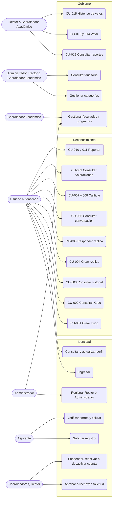

## 2. Clases del dominio

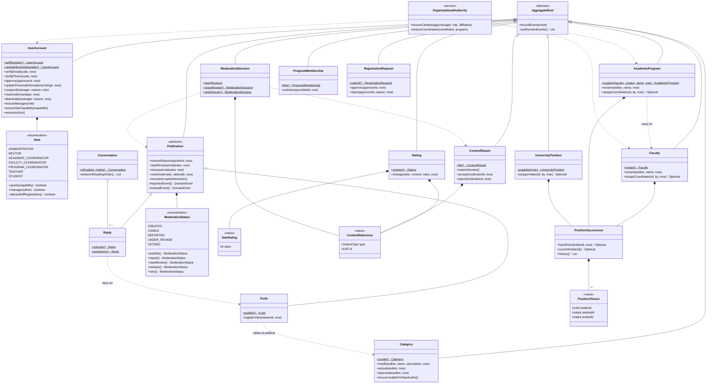

## 3. Secuencia

### Publicar un Kudo

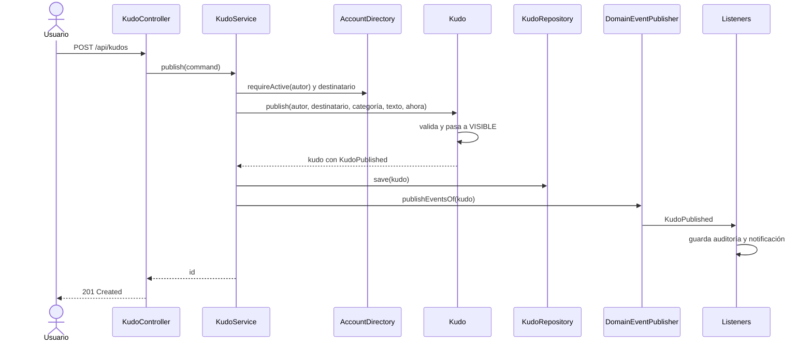

### Aprobar una solicitud

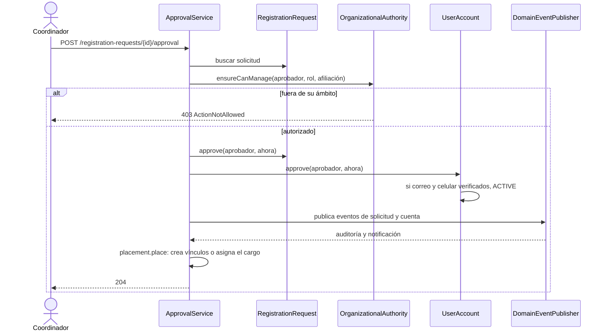

### Cerrar una revisión con veto

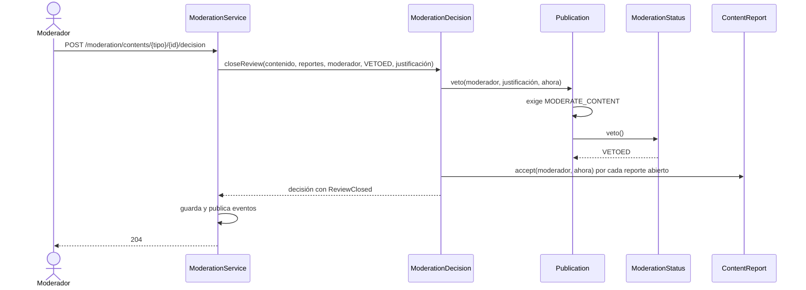

## 4. Actividad

### Del registro a la cuenta activa

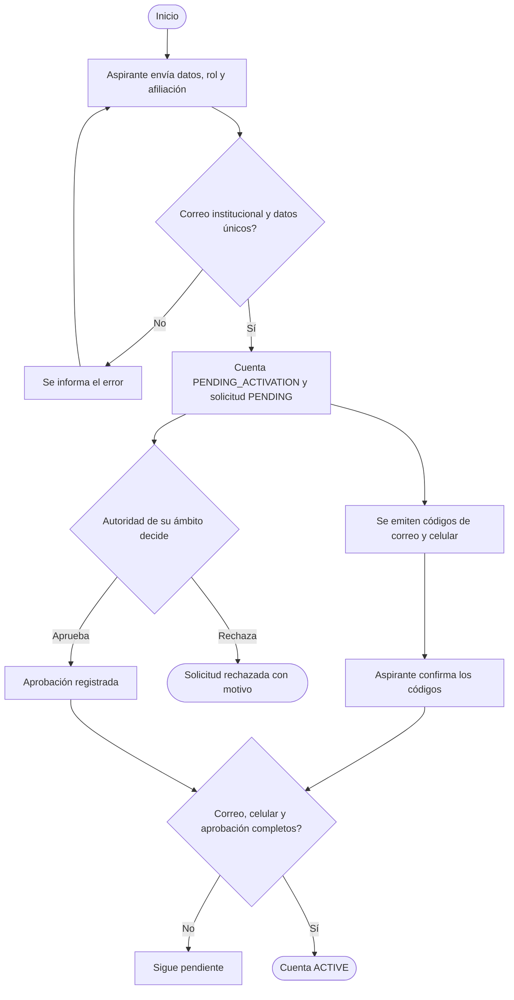

### Moderación de contenido

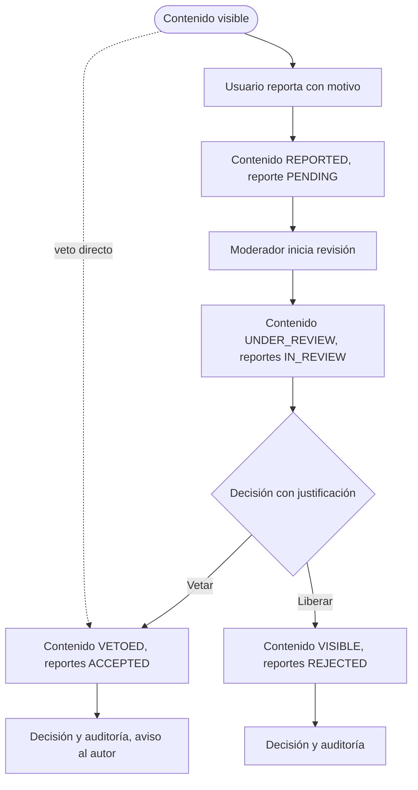

## 5. Estados

### Kudo y réplica

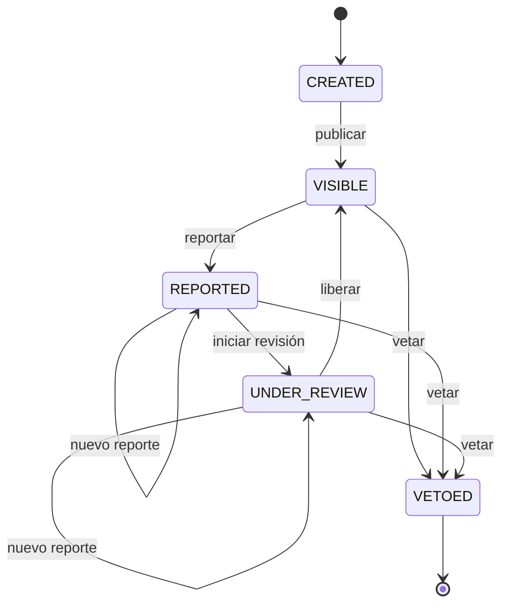

### Reporte

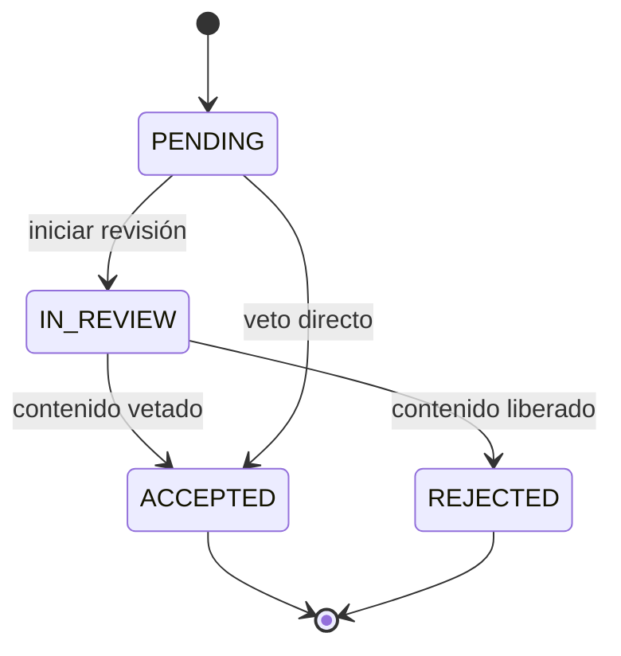

### Cuenta

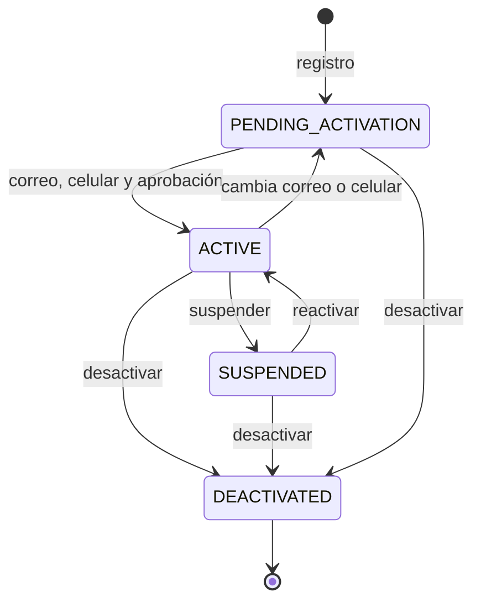

### Solicitud de registro

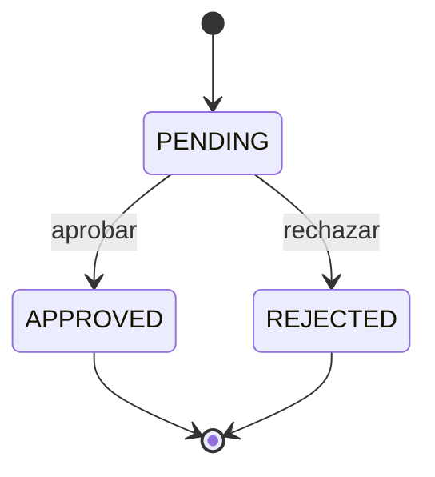
