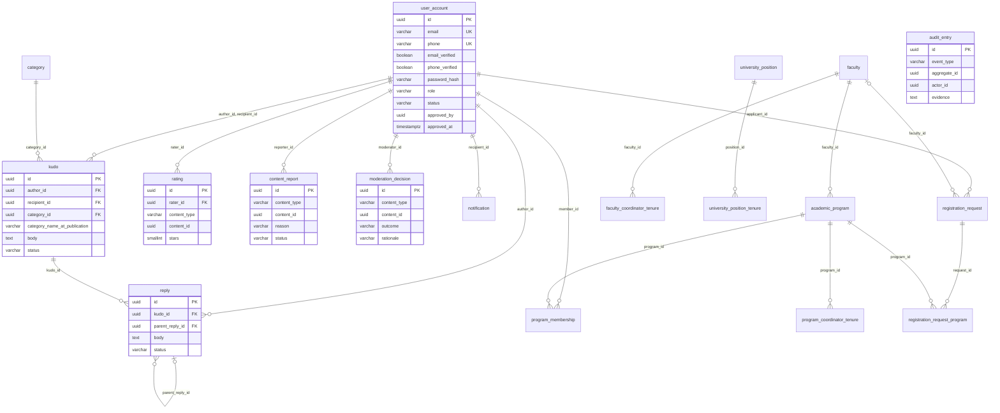
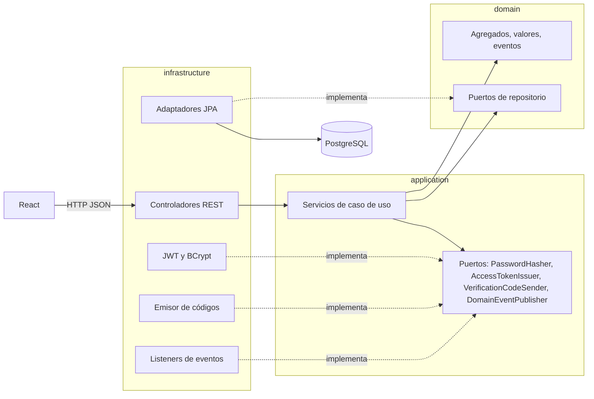

# Modelo de datos, arquitectura y patrones

## 1. Modelo de datos

PostgreSQL. El esquema lo crean las migraciones de Flyway en `uco-kudos-backend/src/main/resources/db/migration`.

El modelo de datos se mantiene en draw.io: `modelos/Modelo_Datos_UCOKudos.drawio`. Su primera página muestra las entidades con sus relaciones y multiplicidades; la segunda, cada tabla con sus columnas.

`audit_entry` no tiene claves foráneas a propósito: la auditoría debe sobrevivir a cualquier cambio en lo auditado.

### Reglas que también protege la base

El dominio valida primero, con mensajes claros. La base es la última defensa, sobre todo frente a dos peticiones simultáneas que pasan juntas la validación.

| Restricción | Regla |
|---|---|
| `uk_user_account_email`, `uk_user_account_phone` | RN-073, RN-074 |
| `ck_user_account_active_requirements` | RN-085 a RN-088 |
| `uk_faculty_single_current_tenure` y equivalentes (índices únicos parciales) | INV-001 a INV-004 |
| `uk_program_membership_single_active_link` | Un solo vínculo vigente por persona y programa |
| `ck_registration_not_self_decided` | RN-108 |
| `ck_kudo_recognizes_someone_else` | CU-001 |
| `ck_reply_not_self_parent` | INV-028 |
| `uk_rating_one_per_rater_and_content`, `ck_rating_stars` | RN-177 a RN-181 |
| `ck_report_other_needs_detail` | Decisión D-10 |

Los índices parciales están en una migración aparte (`V2`) porque H2, usada en pruebas, no los soporta. Esas cuatro garantías solo existen en PostgreSQL; en las pruebas automáticas las cubre la validación del dominio, y se comprobaron aparte contra PostgreSQL 18.

Decisiones:

- **`TEXT` para contenido.** RN-152 y RN-170 prohíben límites.
- **Árbol por lista de adyacencia con `kudo_id` en cada réplica.** Una sola consulta trae toda la conversación, sin recursión SQL, y `Conversation` reconstruye el orden en memoria.
- **Referencia polimórfica `content_type` + `content_id`** en calificación, reporte y decisión. Cuesta la clave foránea, pero evita dos columnas anulables en cada tabla. El dominio verifica que el contenido exista.
- **UUID** generados por el dominio: un agregado tiene identidad antes de guardarse.
- **Nombre de categoría copiado en `kudo`.** RN-145: renombrar no reescribe la historia.

## 2. Arquitectura

Hexagonal (puertos y adaptadores). Se eligió porque el valor del proyecto está en las reglas, y este estilo las deja independientes de Spring, JPA y HTTP (ARQ-041, ARQ-042).

| Capa | Paquete | Puede depender de |
|---|---|---|
| Dominio | `domain` | Solo Java |
| Aplicación | `application` | Dominio; de Spring únicamente `@Transactional` |
| Infraestructura | `infrastructure` | Todo |

Las dependencias apuntan hacia adentro y `ArchitectureTest` (ArchUnit) hace fallar `mvn verify` si alguien rompe la regla. La única concesión consciente es `@Transactional` en aplicación: envolverlo en una abstracción propia añadiría código sin beneficio real.

Las entidades JPA son clases distintas de las del dominio (`Entity.from` y `toDomain`). Cuesta algo de mapeo, pero impide que las necesidades de Hibernate, como constructores vacíos y setters, debiliten el encapsulamiento.

**Evolución.** Un proveedor real de SMS es un adaptador nuevo. Un nuevo tipo de reacción a eventos es un listener nuevo. Un nuevo permiso es una constante en `Capability`.

**Seguridad.** JWT firmado con HS256, sesión sin estado, claves con BCrypt, CORS limitado al origen del Front-End. La autorización de negocio se comprueba en el dominio, no en anotaciones del controlador, para que ninguna entrada futura pueda saltársela.

**Concurrencia.** Las reglas de unicidad las protege la base. Los cambios de estado de una publicación (reportar, iniciar revisión, decidir y vetar) cargan la fila con bloqueo pesimista mediante `PublicationCatalog.requireForUpdate`. La segunda petición espera, lee el estado real y `ModerationStatus` la rechaza si la transición ya no es válida. Se prefirió al bloqueo optimista porque cada guardado reconstruye la entidad JPA desde el dominio, y `@Version` obligaría a llevar la versión por el modelo. Con solo dos moderadores, la espera es mínima.

**Escalabilidad.** Sesión sin estado, consultas paginadas, índices en las columnas de consulta y conteos agregados por consulta para evitar el problema N+1.

**Errores.** `GlobalExceptionHandler` traduce a `application/problem+json`: regla incumplida 422, sin permiso 403, inexistente 404, credenciales 401, conflicto de datos 409, validación 400.

## 3. Patrones utilizados

Cada patrón responde a un problema concreto (ARQ-058 a ARQ-061).

| Patrón | Dónde | Problema que resuelve |
|---|---|---|
| **State** | `ModerationStatus` | Cada estado define qué transiciones admite. Sin él, `Publication` tendría condicionales repetidos en cinco operaciones. Un enum con métodos por constante da el patrón sin una clase por estado (KISS) |
| **Observer** | `DomainEventPublisher` y listeners | Publicar un Kudo no debe saber que existen auditoría y notificaciones. Agregar una reacción no toca al dominio |
| **Repository** | Interfaces en `domain`, adaptadores en `infrastructure` | El dominio persiste sin conocer JPA, y las pruebas unitarias no necesitan base de datos |
| **Template Method** | `Publication.receiveReport` y `veto` llaman a `reportedEvent` y `vetoedEvent` | El flujo es común; solo cambia el evento concreto |
| **Factory Method** | `Kudo.publish`, `Reply.onKudo`, `Reply.answering`, `UserAccount.selfRegister` | Un constructor no comunica la intención, y cada forma de crear tiene reglas propias |
| **Adapter** | `*PersistenceAdapter`, `BCryptPasswordHasher`, `JwtAccessTokenIssuer` | Conecta puertos propios con librerías externas |
| **Specification** | `AuditTrailPersistenceAdapter`, con la API de Spring Data | Búsqueda con filtros opcionales combinables sin una consulta por combinación |

Considerados y **descartados**:

| Patrón | Por qué no |
|---|---|
| Composite | Las réplicas forman un árbol, pero no hay operación que se aplique igual a hoja y rama; los datos llegan planos y `Conversation` los ordena |
| Strategy | No hay algoritmos intercambiables en ejecución. `Role` resuelve la variación con datos |
| Chain of Responsibility | La cadena de aprobación tiene un único responsable por rol: es una tabla, no una cadena de intentos |
| Builder | Los objetos se crean con pocos datos, ya agrupados en registros como `NewAccountData` |
| Abstract Factory | No existen familias de objetos que varíen juntas |
| Command | Sin deshacer ni colas. `RegisterAccountCommand` es solo un objeto de datos pese al nombre usual |

## 4. Principios

| Principio | Evidencia |
|---|---|
| Encapsulamiento | Agregados sin setters; el estado cambia solo mediante operaciones con significado |
| Polimorfismo | `Publication` y el comportamiento por constante en `ModerationStatus` |
| Composición | `Faculty`, `AcademicProgram` y `UniversityPosition` contienen `PositionSuccession` en vez de heredarla |
| SRP | Un servicio por área de casos de uso; listeners separados para auditar y notificar |
| OCP | Nuevas reacciones sin modificar emisores |
| LSP | `Kudo` y `Reply` cumplen el mismo contrato de `Publication`, que es sellada |
| ISP | Un puerto por capacidad (`PasswordHasher`, `AccessTokenIssuer`, ...) y por agregado |
| DIP | Aplicación depende de puertos; `ApplicationServicesConfiguration` conecta las implementaciones |
| Tell, Don't Ask | `content.veto(moderador, ...)`; el servicio no consulta estados para decidir |
| YAGNI | Sin caché, sin colas, sin pantalla de parámetros, sin proveedor real de mensajería |
| KISS | Enum en lugar de jerarquías de estado; listas planas en lugar de árboles anidados en JSON |

Excepción a Ley de Demeter: la regla automática de PMD está desactivada porque marca también los `record` y los flujos de `Stream`; en revisión manual se evitan las cadenas sobre objetos de dominio.
